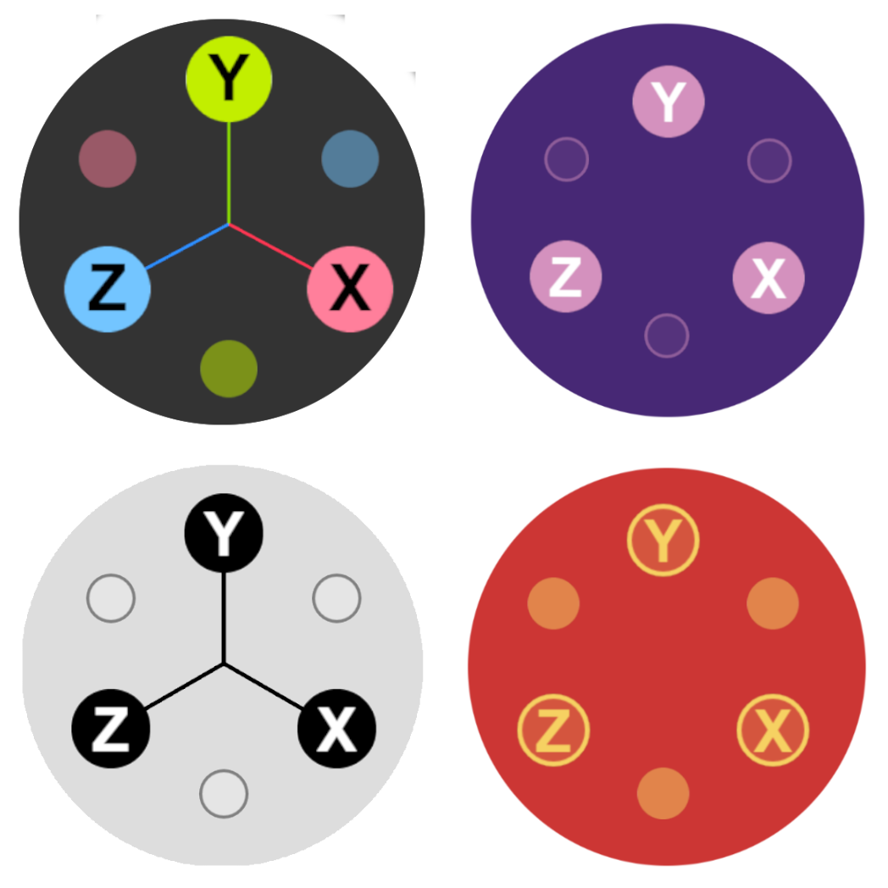

<h1 align="center">Three Viewport Gizmo</h1>

<p align="center">
  <a href="https://taucad.github.io/three-viewport-gizmo/">
  
  </a>
</p>

<a href="https://taucad.github.io/three-viewport-gizmo/">**Three Viewport Gizmo**</a> is a highly customizable standalone interactive version of the official [three.js viewport helper](https://github.com/mrdoob/three.js/blob/dev/examples/jsm/helpers/ViewHelper.js), it can be used alone or in conjuncture with [OrbitControls](https://threejs.org/docs/#examples/en/controls/OrbitControls) or custom camera controllers like [@yomotsu/camera-controls](https://github.com/yomotsu/camera-controls).

<h3 align="center">
  📚 <a href="https://taucad.github.io/three-viewport-gizmo/">Documentation</a> -
  🚀 <a href="https://taucad.github.io/three-viewport-gizmo/docs/quickstart/">Quickstart</a> -
  🛠️ <a href="https://taucad.github.io/three-viewport-gizmo/docs/api/">API</a> -
  🎛️ <a href="https://taucad.github.io/three-viewport-gizmo/playground/">Playground</a> -
  🧩 <a href="https://taucad.github.io/three-viewport-gizmo/matrix/">Matrix</a>
</h3>

---

## Quick Start

### Installation

```sh
npm install @taulabs/three-viewport-gizmo
```

### Usage

```js
import * as THREE from "three";
import { OrbitControls } from "three/addons/controls/OrbitControls.js";
import { ViewportGizmo } from "@taulabs/three-viewport-gizmo";

//... Initialize your Scene

const controls = new OrbitControls(camera, renderer.domElement);
const gizmo = new ViewportGizmo(camera, renderer);

gizmo.attachControls(controls);

// Render
function animation(time) {
  //... Scene's animations and render

  gizmo.render();
}

// Resize
window.onresize = () => {
  //... Scene's resize logic

  gizmo.update();
};
```

## WebGPU (`WebGPURenderer`)

`ViewportGizmo` accepts the same `renderer` argument you already pass everywhere: either the legacy **`WebGLRenderer`** or **`WebGPURenderer`** (`import * as THREE from "three/webgpu"`). Detection uses the renderer’s `isWebGPURenderer` flag from three.js itself (no caller configuration).

Important details:

1. **`WebGPURenderer` must finish async init** before clearing or relying on pixels; call **`await renderer.init()`** once after constructing the renderer. See the [WebGPU guide](https://taucad.github.io/three-viewport-gizmo/docs/webgpu/).

2. **Viewport layout** uses the correct `setViewport` y-origin for WebGPU versus WebGL internally (see [#48](https://github.com/Fennec-hub/three-viewport-gizmo/issues/48)).

3. **Shared renderer caveat** — using the same `WebGPURenderer` instance for both the main scene and a sub-rect gizmo pass can interact badly with three.js’s internal offscreen framebuffer + composite quad in some setups. Prefer a **dedicated smaller canvas/renderer** only for the gizmo (the pattern documented on the deployed docs site).

To compare renderers, up axes, gizmo types and controllers, use the **[Playground](https://taucad.github.io/three-viewport-gizmo/playground/)** (the configuration is in the URL) and the **[Matrix](https://taucad.github.io/three-viewport-gizmo/matrix/)** (every up axis on both renderers at once).

## Acknowledgments

- Tau maintains this fork of [three-viewport-gizmo](https://github.com/Fennec-hub/three-viewport-gizmo) by Fennec.
- Thanks to the [Three.js](https://threejs.org/) community for their amazing work.
- This library was inspired from the official [Three.js Viewport Helper](https://github.com/mrdoob/three.js/blob/dev/examples/jsm/helpers/ViewHelper.js).

## License

This project is licensed under the MIT License

### Contribution and Support

If you have any questions or need support, feel free to [open an issue](https://github.com/taucad/three-viewport-gizmo/issues).

Contributions are welcome! Fork the repository, make your changes, and submit a pull request.
